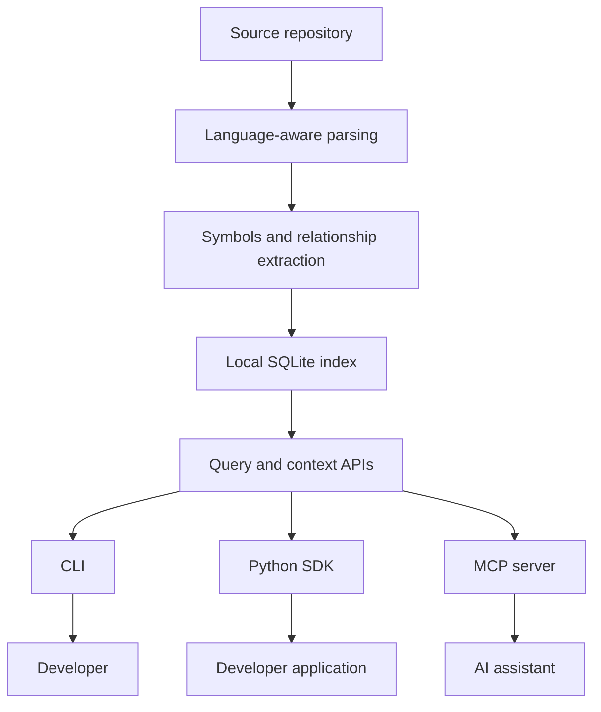
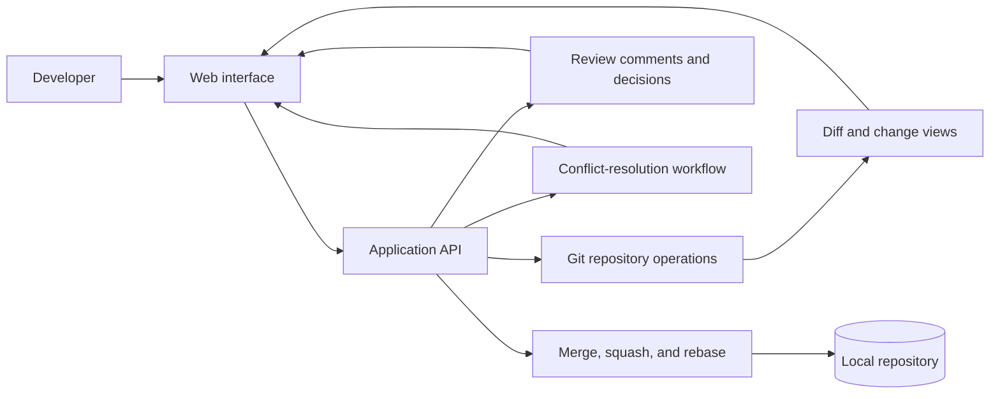
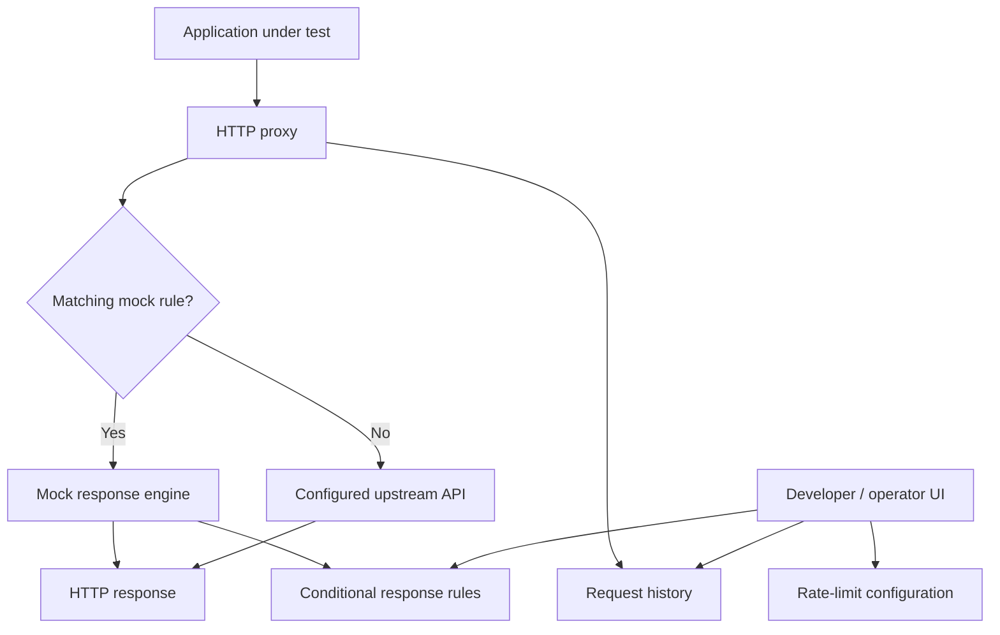
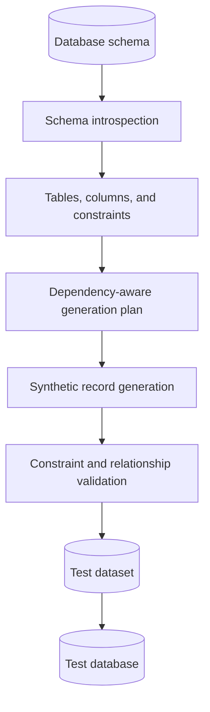
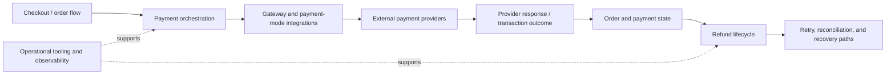

# Selected System Architecture Notes

These diagrams are intentionally **high-level and conceptual**. They describe public project capabilities and the boundaries visible from their documentation; they are not production deployment diagrams, exhaustive data-flow maps, or disclosures of employer-internal architecture.

## 1. JSAT — codebase intelligence

JSAT builds a local structural index of a repository and makes it available to developer tools and AI clients.

**Design themes:** index once, query repeatedly; keep the index local and inspectable; expose the same repository context through multiple interfaces.

## 2. PRView — local pull-request workflow

PRView brings repository comparison and review actions into a local application.

**Design themes:** keep review context close to the repository; make Git operations explicit; present review feedback and repository state in one workflow.

## 3. PED Tools — HTTP proxy and mock server

PED Tools helps developers inspect API traffic and simulate upstream behavior during integration work.

**Design themes:** deterministic test behavior, visibility into requests, and fewer dependencies on live third-party services.

## 4. JaySoft DBMocker — schema-aware synthetic data

DBMocker uses database schema information to generate test data while respecting relational constraints.

**Design themes:** schema-driven generation, referential integrity, and repeatable datasets for integration testing.

## 5. Payment and refund platform contributions

The following is a contribution-level view of the problem space, not a representation of Fynd's internal services or production topology.

**Engineering concerns:** idempotent operations, retries, provider failures, transaction-state consistency, secure integration boundaries, and observable recovery paths.

---

## How to read these diagrams

- Arrows show conceptual responsibility or information flow, not guaranteed synchronous calls.
- Storage and technology labels are included only where they are part of the publicly described project.
- The payment diagram deliberately avoids internal service names, event schemas, infrastructure topology, credentials, or proprietary implementation details.
- For source code and implementation details, follow the repository links from the [portfolio](../index.html) and [case studies](../projects.html).
